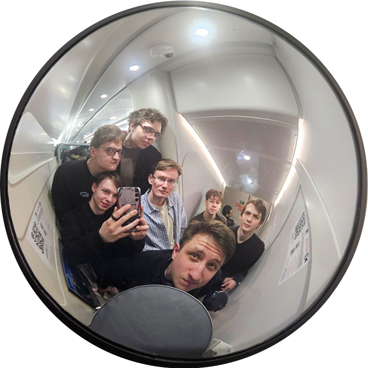
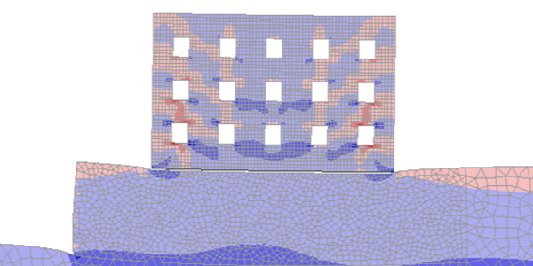
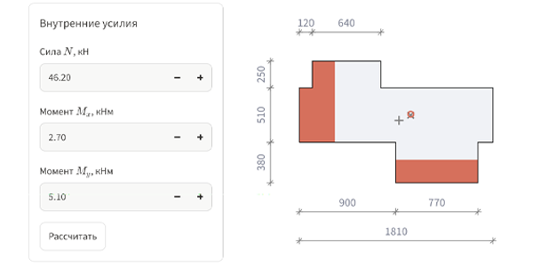
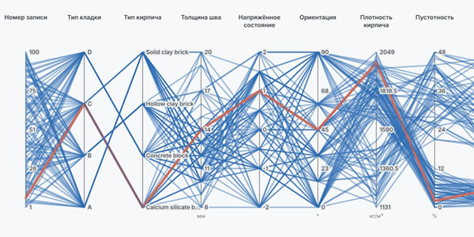
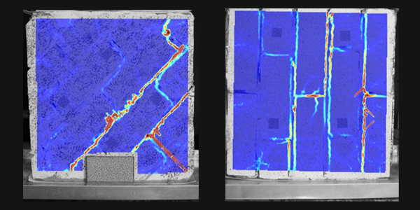
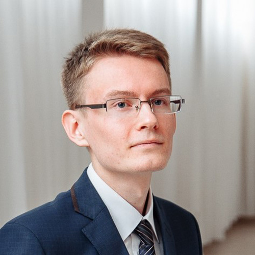
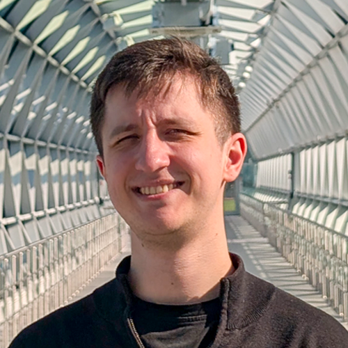

::::::::: column-margin

:::::::::

::: callout-important
### 3 декабря в ННГАСУ пройдет открытая встреча со студентами

На встрече мы расскажем о направлениях деятельности кружка и планах работы на следующий год. Время и место сообщим позднее, пройдите [регистрацию](https://forms.yandex.ru/u/6af3059ede8ec3a2c56e3ac5/), мы пришлем вам уведомление.
:::

::: callout-important
### 10 декабря в ННГАСУ пройдет конференция «Современное строительство: конструкции, материалы, технологии»

На [конференции](https://nngasu.ru/science/zodchiy-budushchego/sov-stroitelstvo.php) руководитель кружка представит доклады по результатам работы кружка за прошедший год, в частности, по экспериментальной части и машинному обучению.
:::

Изучаем, как реальные строительные материалы и конструкции ведут себя за пределами линейной упругости. Пишем код, ставим реальные и численные эксперименты, делаем доклады и публикуем статьи. Деятельность кружка будет наиболее интересна студентам следующих направлений:

- 08.03.01 «Строительство» (бакалавриат) 3-4 курс
- 08.04.01 «Строительство» (магистратура) 1-2 курс
- 08.05.01 «Строительство уникальных зданий и сооружений» (специалитет) 3-6 курс

::: hero-actions
[Задать вопрос](https://t.me/maksimlpozdeev){.btn .btn-outline-primary}
:::

## Научная деятельность

На данный момент кружок занимается исследовательскими работами в области физической нелинейности строительных конструкций из каменных кладок.

::::::::: column-margin

Ближайшие мероприятия

:::::::: timeline
::: {.tl-item data-date="2026-10-28"}
[Октябрь 2026]{.tl-date}

[Нижегородский фестиваль науки]{.tl-title}
:::

::: {.tl-item data-date="2026-12-03"}
[3 декабря 2026]{.tl-date}

[Открытая встреча со студентами]{.tl-title}
:::

::: {.tl-item data-date="2026-12-10"}
[10 декабря 2026]{.tl-date}

[Конференция «Современное строительство: конструкции, материалы, технологии»]{.tl-title}
:::

::: {.tl-item data-date="2027-04-15"}
[Апрель 2027]{.tl-date}

[II конференция им. В.В. Найденко, Нижний Новгород]{.tl-title}
:::

::: {.tl-item data-date="2027-05-15"}
[Май 2027]{.tl-date}

[X Международный симпозиум (APSCSE-2027), Красноярск]{.tl-title}
:::

::: {.tl-item data-date="2027-09-15"}
[Сентябрь 2027]{.tl-date}

[XV конференция «Золотовские чтения», Москва]{.tl-title}
:::
::::::::

```{=html}
<script>
// Делит события на прошедшие и будущие по текущей дате.
(function () {
  var tl = document.querySelector(".timeline");
  if (!tl) return;
  var now = new Date();
  var today = new Date(now.getFullYear(), now.getMonth(), now.getDate());
  var firstFuture = null;

  tl.querySelectorAll(".tl-item[data-date]").forEach(function (el) {
    var p = el.getAttribute("data-date").split("-");
    var d = new Date(+p[0], +p[1] - 1, +p[2]);
    if (d < today) {
      el.classList.add("is-past");
    } else if (!firstFuture) {
      firstFuture = el;
      el.classList.add("is-next");
    }
  });
})();
</script>
```
:::::::::

::::::::::::::: grid
::::: {.g-col-12 .g-col-md-6}
:::: {.card .h-100 .accent}
::: card-body


### Численное моделирование
:::
::::
:::::

::::: {.g-col-12 .g-col-md-6}
:::: {.card .h-100 .accent}
::: card-body


### Разработка инженерных калькуляторов
:::
::::
:::::

::::: {.g-col-12 .g-col-md-6}
:::: {.card .h-100 .accent}
::: card-body


### Базы данных и машинное обучение
:::
::::
:::::

::::: {.g-col-12 .g-col-md-6}
:::: {.card .h-100 .accent}
::: card-body


### Экспериментальная работа
:::
::::
:::::
:::::::::::::::

## Образовательная деятельность

В 2027 году планируется проведение серии образовательных мероприятий, которые помогут студентам освоить необходимые навыки для работы в кружке.

::::::::::::::: grid
:::::: {.g-col-12 .g-col-md-4}
::::: {.card .h-100}
:::: card-body
::: icon
[terminal]{.material-symbols-outlined}
:::
### Основы Python

Расскажем основы языка и рассмотрим наиболее популярные библиотеки для выполнения инженерных расчетов и визуализации, такие как NumPy, Matplotlib и другие.
::::
:::::
::::::

:::::: {.g-col-12 .g-col-md-4}
::::: {.card .h-100}
:::: card-body
::: icon
[shape_line]{.material-symbols-outlined}
:::
### Основы МКЭ

Напишем собственную программу для расчета простой стержневой конструкции и визуализируем результаты расчета с помощью Python и библиотек.
::::
:::::
::::::

:::::: {.g-col-12 .g-col-md-4}
::::: {.card .h-100}
:::: card-body
::: icon
[line_axis]{.material-symbols-outlined}
:::
### Физическая нелинейность

Освоим базовые понятия теории пластичности, а также положения, лежащие в основе нелинейной деформационной модели железобетона и каменной кладки.
::::
:::::
::::::
:::::::::::::::

## Руководитель и преподаватели

Руководитель кружка и преподаватели являются сотрудниками кафедр «Железобетонные, каменные и деревянные конструкции», «Теория сооружений и техническая механика» ННГАСУ, а также инженерами-исследователями ГК «SCAD Soft».

::::::::::: grid
::::: {.g-col-12 .g-col-md-4}
:::: {.card .h-100}
::: card-body


### Максим Леонидович Поздеев

руководитель кружка, канд. техн. наук, ст. преп. каф. ЖБКиДК ННГАСУ, инженер-исследователь ГК «SCAD Soft»
:::
::::
:::::

::::: {.g-col-12 .g-col-md-4}
:::: {.card .h-100}
::: card-body


### Илья Васильевич Смагин

преподаватель кружка, аспирант, ассистент каф. ТСиТМ ННГАСУ, инженер-исследователь ГК «SCAD Soft»
:::
::::
:::::

:::: {.g-col-12 .g-col-md-4}

::::
:::::::::::

## Участники

В работе кружка участвуют студенты ННГАСУ, которые проявляют интерес к исследовательской деятельности в области физической нелинейности строительных конструкций. Также для выполнения отдельных задач кружка привлекаются студенты, занимающиеся разработкой программных средств.

| Члены кружка                 | Участие        | Тезисы РИНЦ | Статьи ВАК |
| :--------------------------- | :------------- | :---------- | :--------- |
| Сергей Максимович Колос      | 2025 -- н. вр. |             |            |
| Степан Юрьевич Королев       | 2025 -- н. вр. | 1           |            |
| Иван Дмитриевич Молодцов     | 2025 -- н. вр. |             |            |
| Валерия Игоревна Пестрикова  | 2025 -- н. вр. | 1           |            |
| Никита Сергеевич Пироговский | 2025 -- н. вр. | 1           |            |
| Андрей Эдуардович Романов    | 2025 -- н. вр. | 1           |            |

## Публикации

::: {#club-papers}
:::

## Вопросы

::: {.callout-note .faq}
### С какого курса можно вступить?

Наиболее комфортно будет с 3 курса бакалавриата или специалитета, но можно начать со 2 курса. Главное -- желание и интерес к теме.
:::

::: {.callout-note .faq}
### Сколько времени занимает участие?

Ориентировочно несколько часов в неделю: занятия курсов плюс самостоятельная работа над своей темой. Нагрузку можно согласовать с руководителем.
:::

::: {.callout-note .faq}
### Что я могу получить?

Опыт исследовательской работы, выступления на конференциях, публикации. Надинженерные навыки: программирование, численные методы, экспериментальная работа. За научную деятельность студент ННГАСУ также вправе претендовать на получение повышенной академической стипендии: [см. информацию](https://vk.com/wall-61860843?id=61860843&q=ПГАС).
:::

::: {.callout-note .faq}
### Нужно ли уметь программировать или знать МКЭ?

Нет, но такие знания приветствуются. Курсы внутри кружка: «Основы Python» и «Основы МКЭ» рассчитаны на студентов, закончивших 2-3 курс бакалавриата или специалитета.
:::

::: {.callout-note .faq}
### Вы занимаетесь только каменной кладкой?

Тематика кружка связана с научной деятельностью руководителя, занимающегося вопросами физической нелинейности применительно к каменной кладке: [см. диссертацию](https://kgeu.ru/struktura-vuza/dissertatsionnye-sovety/dissertatsionnyy-sovet-24-2-310-04/soiskatel-pozdeev-maksim-leonidovich/). Но в рамках кружка можно заниматься и другими темами, связанными с физической нелинейностью строительных конструкций. Также вы можете посещать образовательные мероприятия кружка, не участвуя в исследовательской деятельности.
:::