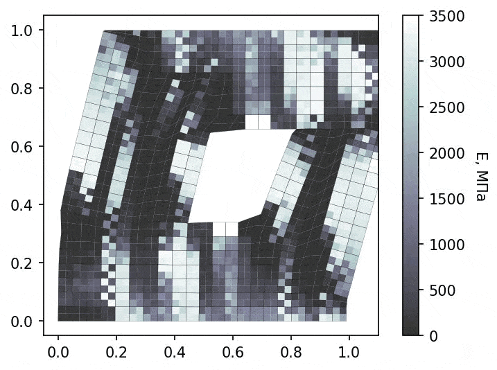
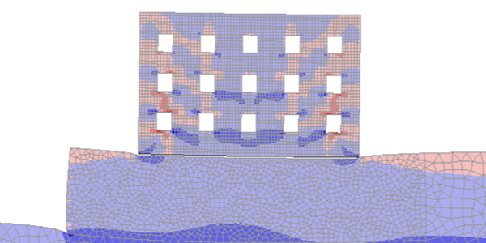
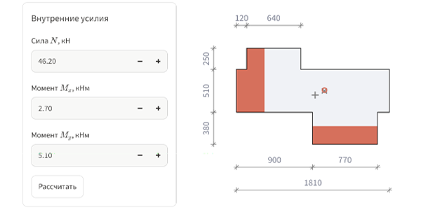
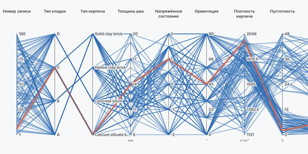
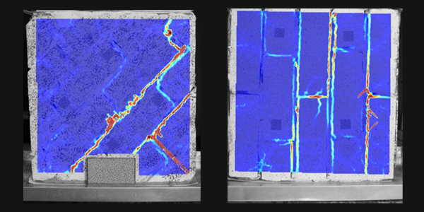
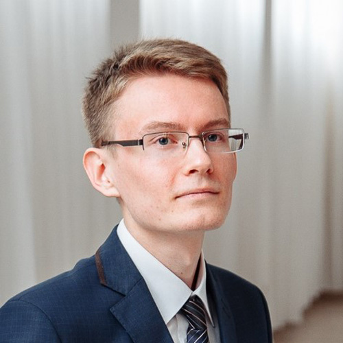
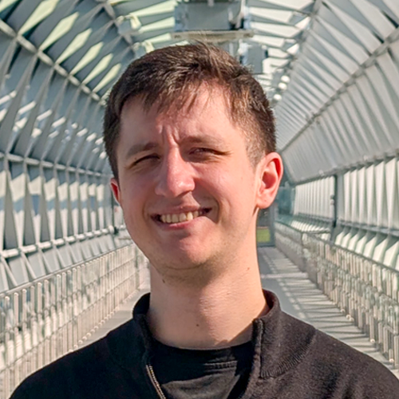
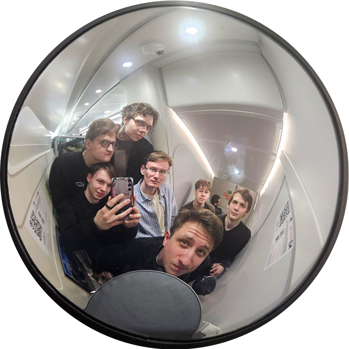

## О кружке

Изучаем, как реальные строительные материалы и конструкции ведут себя за пределами линейной упругости.

Пишем код, ставим реальные и численные эксперименты, делаем доклады и публикуем статьи.

**Кому будет интересно:**

- 08.03.01 «Строительство» (бакалавриат), 3–4 курс
- 08.04.01 «Строительство» (магистратура), 1–2 курс
- 08.05.01 «Строительство уникальных зданий и сооружений» (специалитет), 3–6 курс
- студенты кафедры информационных систем и технологий

## Ближайшие события

::: callout-important
### 3 декабря --- открытая встреча со студентами в ННГАСУ

Расскажем о направлениях деятельности кружка и планах работы на следующий год. Время и место сообщим позднее, [пройдите регистрацию](https://forms.yandex.ru/u/6af3059ede8ec3a2c56e3ac5/), мы пришлем уведомление.
:::

## Научная деятельность

Кружок занимается исследовательскими работами в области физической нелинейности строительных конструкций из каменных кладок.

::::::: columns
::: {.column .card}

**Численное моделирование**
:::

::: {.column .card}

**Инженерные калькуляторы**
:::
:::::::

## Научная деятельность

Кружок занимается исследовательскими работами в области физической нелинейности строительных конструкций из каменных кладок.

::::::: columns
::: {.column .card}

**Базы данных и машинное обучение**
:::

::: {.column .card}

**Экспериментальная работа**
:::
:::::::

## План мероприятий

| Когда | Событие |
|:-------------------------------|:---------------------------------------|
| Октябрь 2026 | Нижегородский фестиваль науки |
| 3 декабря 2026 | Открытая встреча со студентами |
| 10 декабря 2026 | Конференция «Современное строительство: конструкции, материалы, технологии» |
| Апрель 2027 | II конференция им. В.В. Найденко, Нижний Новгород |
| Май 2027 | X Международный симпозиум (APSCSE-2027), Красноярск |
| Сентябрь 2027 | XV конференция «Золотовские чтения», Москва |

## Образовательная деятельность

В 2027 году планируется серия образовательных мероприятий, которые помогут освоить навыки для работы в кружке.

::::::::: columns
:::: {.column .card}
::: icon
[terminal]{.material-symbols-outlined}
:::

### Основы Python

Основы языка и самые популярные библиотеки для инженерных расчетов и визуализации: NumPy, Matplotlib и другие.
::::

:::: {.column .card}
::: icon
[shape_line]{.material-symbols-outlined}
:::

### Основы МКЭ

Пишем собственную программу для расчета простой стержневой конструкции и визуализируем результаты с помощью Python.
::::

:::: {.column .card}
::: icon
[line_axis]{.material-symbols-outlined}
:::

### Физическая нелинейность

Базовые понятия теории пластичности и положения нелинейной деформационной модели железобетона и каменной кладки.
::::
:::::::::

## Руководитель и преподаватели

Сотрудники кафедр «Железобетонные, каменные и деревянные конструкции» и «Теория сооружений и техническая механика» ННГАСУ, а также инженеры-исследователи ГК «SCAD Soft».

::::: {.columns .card}
::: {.column width="20%"}

:::

::: {.column width="80%"}
### Максим Леонидович Поздеев

руководитель кружка, канд. техн. наук, ст. преп. каф. ЖБКиДК ННГАСУ, инженер-исследователь ГК «SCAD Soft»
:::
:::::

::::: {.columns .card}
::: {.column width="20%"}

:::

::: {.column width="80%"}
### Илья Васильевич Смагин

преподаватель кружка, аспирант, ассистент каф. ТСиТМ ННГАСУ, инженер-исследователь ГК «SCAD Soft»
:::
:::::

## Участники

В работе участвуют студенты ННГАСУ, интересующиеся исследованиями в области физической нелинейности строительных конструкций, а также студенты, занимающиеся разработкой программных средств.

::::: columns
::: {.column width="33%"}

:::

::: {.column width="67%"}
| Члены кружка                 | Участие        | Тезисы РИНЦ | Статьи ВАК |
|:-----------------------------|:---------------|:------------|:-----------|
| Сергей Максимович Колос      | 2025 -- н. вр. |             |            |
| Степан Юрьевич Королев       | 2025 -- н. вр. | 1           |            |
| Иван Дмитриевич Молодцов     | 2025 -- н. вр. |             |            |
| Валерия Игоревна Пестрикова  | 2025 -- н. вр. | 1           |            |
| Никита Сергеевич Пироговский | 2025 -- н. вр. | 1           |            |
| Андрей Эдуардович Романов    | 2025 -- н. вр. | 1           |            |
:::
:::::

## Вопросы и ответы

::: callout-note
### С какого курса можно вступить?

Наиболее комфортно с 3 курса бакалавриата или специалитета, но можно начать со 2 курса. Главное --- желание и интерес к теме.
:::

::: callout-note
### Сколько времени занимает участие?

Ориентировочно несколько часов в неделю: занятия курсов плюс самостоятельная работа над своей темой. Нагрузку можно согласовать с руководителем.
:::

::: callout-note
### Что я могу получить?

Опыт исследовательской работы, выступления на конференциях, публикации. Инженерные навыки: программирование, численные методы, экспериментальная работа. За научную деятельность студент ННГАСУ вправе претендовать на повышенную академическую стипендию ([см. информацию](https://vk.com/wall-61860843?id=61860843&q=ПГАС)).
:::

------------------------------------------------------------------------

::: callout-note
### Нужно ли уметь программировать или знать МКЭ?

Нет, но такие знания приветствуются. Курсы «Основы Python» и «Основы МКЭ» рассчитаны на студентов, закончивших 2–3 курс бакалавриата или специалитета.
:::

::: callout-note
### Вы занимаетесь только каменной кладкой?

Тематика связана с научной деятельностью руководителя, занимающегося физической нелинейностью каменной кладки ([см. диссертацию](https://kgeu.ru/struktura-vuza/dissertatsionnye-sovety/dissertatsionnyy-sovet-24-2-310-04/soiskatel-pozdeev-maksim-leonidovich/)). Но можно заниматься и другими темами по физической нелинейности строительных конструкций, а также посещать образовательные мероприятия, не участвуя в исследованиях.
:::