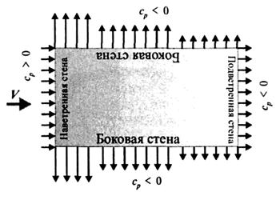
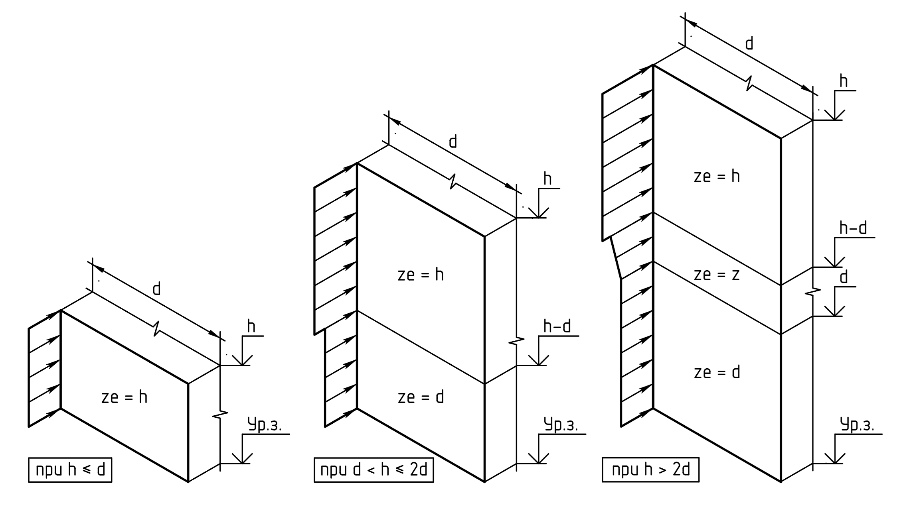
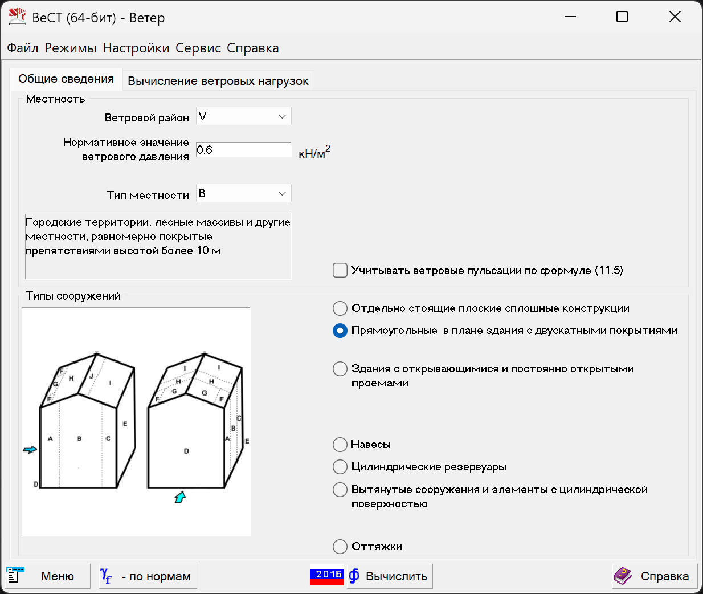
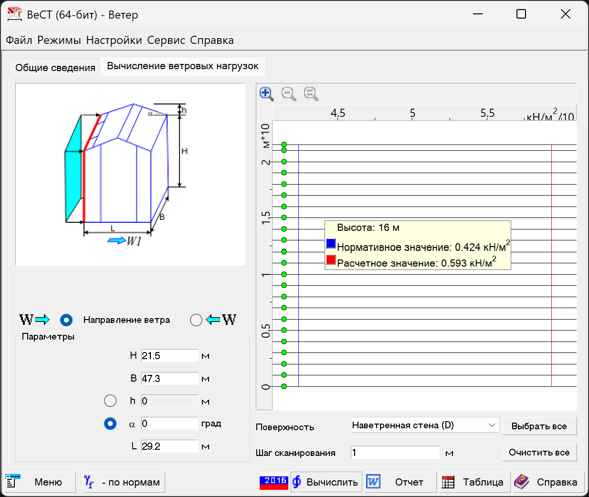
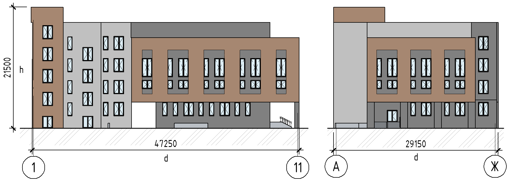
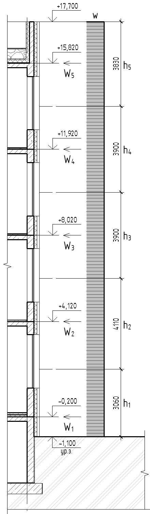
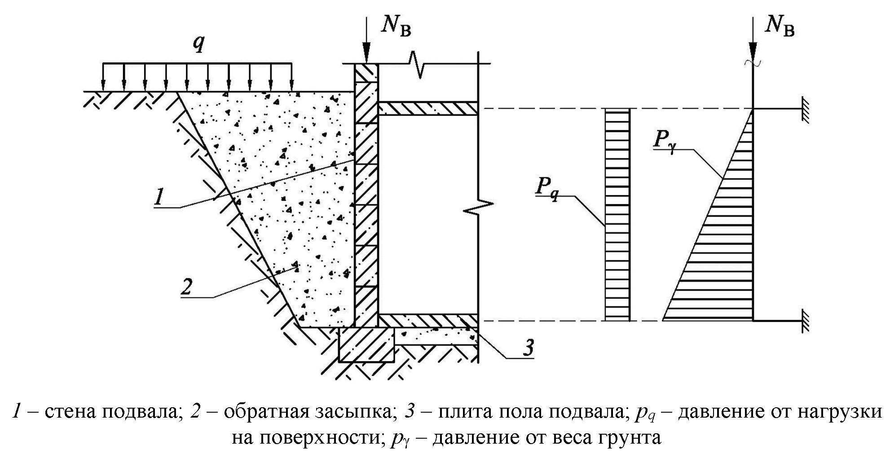
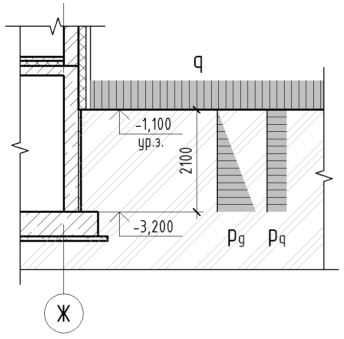

::: column-margin
[← К списку уроков](index.qmd)

[⇲ Скачать материалы курса](https://drive.google.com/drive/folders/1dlvQ6eQCNpVPVrjqIdcA2aRlp87ZvI75?usp=drive_link)

------------------------------------------------------------------------

Другие полезные ссылки:

[🌏︎ Онлайн-калькулятор Webcad](http://webcad.pro/rasch.html)
:::

```{=html}
<div style="position: relative; width: 100%; padding-top: 56.25%; margin: 1em 0;">
  <iframe 
    src="https://vkvideo.ru/video_ext.php?oid=-241507062&id=456239019&hash=eb28dafcb64fb067&hd=3"
    style="position: absolute; top: 0; left: 0; width: 100%; height: 100%; background-color: #000;"
    frameborder="0"
    allow="autoplay; encrypted-media; fullscreen; picture-in-picture; screen-wake-lock;"
    allowfullscreen>
  </iframe>
</div>
```

[00:00](https://vkvideo.ru/video-241507062_456239019?t=0h0m0s) – Классификация нагрузок\
[00:38](https://vkvideo.ru/video-241507062_456239019?t=0h0m38s) – Полы и кровля\
[07:28](https://vkvideo.ru/video-241507062_456239019?t=0h7m28s) – Внутренние перегородки и наружные стены\
[18:42](https://vkvideo.ru/video-241507062_456239019?t=0h18m42s) – Полезные нагрузки\
[22:47](https://vkvideo.ru/video-241507062_456239019?t=0h22m47s) – Снеговая нагрузка

## Исходные данные

Районы строительства принять [по вариантам](tutorial-04.qmd#исходные-данные).

## Конспект

### Классификация нагрузок

Классификация нагрузок изложена в разделе 5 [⇲ СП 20.13330.2016](documents/СП_20.13330.2016_с_Изм_1-6_Нагрузки_и_воздействия_.pdf)

```{mermaid}
flowchart TD
    T[Нагрузки]

    T --> L1[Постоянные]
    T --> L2[Временные]
    T --> L3[Особые]

    L2 --> L21[Кратковременные]
    L2 --> L22[Длительные]
```

### Ветровое воздействие

Расчет воздействия ветра описан в разделе 11 [⇲ СП 20](documents/СП_20.13330.2016_с_Изм_1-6_Нагрузки_и_воздействия_.pdf).

Нормативное значение **основной ветровой нагрузки** $w$ следует определять как сумму средней $w_m$ и пульсационной $w_g$ составляющих

$$
w = w_m + w_g.
$$

#### Средняя составляющая

Нормативное значение **средней составляющей** основной ветровой нагрузки $w_m$ в зависимости от эквивалентной высоты $z_e$ над поверхностью земли следует определять по формуле

$$
w_m = w_0 k(z_e) c,
$$

где $w_0$ -- нормативное значение ветрового давления;\
$k(z_e)$ -- коэффициент, учитывающий изменение ветрового давления для высоты $z_e$;\
$c$ -- аэродинамический коэффициент.

**Нормативное значение ветрового давления $w_0$** определяется по таблице 11.1 [⇲ СП 20](documents/СП_20.13330.2016_с_Изм_1-6_Нагрузки_и_воздействия_.pdf) в зависимости от ветрового района. Район принимается по карте 2 приложения Е [⇲ СП 20](documents/СП_20.13330.2016_с_Изм_1-6_Нагрузки_и_воздействия_.pdf).

**Значения аэродинамических коэффициентов $c$** определяются по приложению В.1 [⇲ СП 20](documents/СП_20.13330.2016_с_Изм_1-6_Нагрузки_и_воздействия_.pdf).

::: column-margin

:::

Для наветренных, подветренных и различных участков боковых стен зданий и сооружений значения аэродинамических коэффициентов $c$ определяются по таблице В.2 [⇲ СП 20](documents/СП_20.13330.2016_с_Изм_1-6_Нагрузки_и_воздействия_.pdf). При этом с наветренной стороны здания $c$ положителен (напор), с подветренной и на боковых стенах -- отрицателен (отсос).

**Эквивалентная высота** $z_e$ определяется:

1 Для башенных сооружений, мачт, труб, решетчатых конструкций и т.п. сооружений\
$z_e = z$.

2 Для зданий:

:::::: {.columns}

::: {.column width="33%"}
а) при $h ≤ d$

$z_e = h$.
:::

::: {.column width="33%"}
б) при $d < h ≤ 2d$:

$z ≥ h-d → z_e=h$;\
$0 < z < h-d → z_e=d$.
:::

::: {.column width="33%"}
в) при $h > 2d$:

$z ≥ h-d → z_e = h$;\
$d < z < h-d → z_e = z$;\
$0 < z ≤ d → z_e = d$.
:::
::::::

Условия а-в графически можно представить на схеме:



Здесь $z$ -- высота от поверхности земли;\
$d$ -- размер здания (без учета его стилобатной части) в направлении, перпендикулярном расчетному направлению ветра (поперечный размер);\
$h$ -- высота здания от поверхности земли.

**Коэффициент** $k(z_e)$ для высот $z_e ≤ 300$ м определяется по таблице 11.2 [⇲ СП 20](documents/СП_20.13330.2016_с_Изм_1-6_Нагрузки_и_воздействия_.pdf) или по формуле

$$
k(z_e) = k_{10} (z_e/10)^{2\alpha}, 10 ≤ z_e ≤ 300 \text{ м}
$$

Значения параметров $k_{10}$ и $\alpha$ для различных **типов местностей** приведены в таблице 11.3 [⇲ СП 20](documents/СП_20.13330.2016_с_Изм_1-6_Нагрузки_и_воздействия_.pdf).

Принимаются следующие типы местности:

:::::: column-page-right
::: {.column width="33%"}

:::

::: {.column width="33%"}

:::

::: {.column width="33%"}

:::
::::::

Расчет средней составляющей может быть произведен в `Excel` или `сателлите Вест пакета SCAD Office`.

::: callout
В онлайн-калькуляторе [Webcad](http://webcad.pro/sp20_veter/sp20_veter.html) реализована только устаревшая версия СП 20.13330.2011.
:::

Вкладка `Местность` позволяет определить основную информацию о климатических районах для заданного района строительства.

:::::: column-page-right
::: {.column width="49%"}

:::

::: {.column width="49%"}

:::
::::::

Вкладка `Ветер` позволяет рассчитать ветровое давление на стены и кровлю зданий или сооружений различных форм. Ниже приведен пример задания параметров для учебного проекта школы для V ветрового района и типа местности B.

:::::: column-page-right
::: {.column width="49%"}

:::

::: {.column width="49%"}

:::
::::::

#### Пример расчета средней составляющей ветровой нагрузки 

Для проектируемого здания для любых направлений ветра $h ≤ d$, следовательно $z_e = h = 21.5 \text{м}$, где $h$ -- высота здания от поверхности земли.



Нагрузка в расчетной схеме будет прикладываться как линейная равномерно распределенная по внешнему контуру перекрытий $W_n$ [кН/м], расположенных на высоте $H_n$ от уровня земли. Нагрузка собирается с грузовой полосы высотой $h_n$, равной расстоянию между серединами смежных этажей.

Поскольку в `сателлите Вест-Ветер пакета SCAD Office` ветровую нагрузку можно посчитать только как распределенную по площади, удобнее провести расчет сразу в `Excel`.

::: column-margin

:::

| Район | Тип местности | $w_0$, кПа | $k_{10}$ | $\alpha$ | $\gamma_f$ |
| :---- | :------------ | :--------- | :------- | :------- | :--------- |
| V     | B             | 0.6        | 0.65     | 0.2      | 1.4        |

: Пример сбора ветровой нагрузки

| $H$, м | $h$, м | $z_e$, м | $k(z_e)$ | Наветренная, | $c = 0.8$   | Подветренная, | $с = 0.5$   |
| :----- | :----- | :------- | :------- | :----------- | :---------- | :------------ | :---------- |
|        |        |          |          | Норм., кН/м  | Расч., кН/м | Норм., кН/м   | Расч., кН/м |
| 0.9    | 3.06   | 21.5     | 0.883    | 1.30         | 1.82        | 0.81          | 1.13        |
| 5.22   | 4.11   | 21.5     | 0.883    | 1.74         | 2.44        | 1.09          | 1.52        |
| 9.12   | 3.9    | 21.5     | 0.883    | 1.65         | 2.31        | 1.03          | 1.45        |
| 13.02  | 3.9    | 21.5     | 0.883    | 1.65         | 2.31        | 1.03          | 1.45        |
| 16.92  | 3.83   | 21.5     | 0.883    | 1.62         | 2.27        | 1.01          | 1.42        |

: Пример сбора ветровой нагрузки (продолжение)

#### Пульсационная составляющая

Нормативное значение **пульсационной составляющей** основной ветровой нагрузки $w_g$ на эквивалентной высоте $z_e$ определяется как доля от средней составляющей $w_m$ и зависит от частот собственных колебаний $f_s$ и предельного значения собственной частоты $f_{lim}$.

| Условие                   | Формула расчета $w_g$                          |
| ------------------------- | ---------------------------------------------- |
| $f_{lim} < f_1$           | $= w_m \zeta(z_e) \nu$                         |
| $f_1 < f_{lim} < f_2$     | $= w_m \xi \zeta(z_e) \nu$                     |
| $f_s < f_{lim} < f_{s+1}$ | с учетом $s$ первых форм собственных колебаний |

::: callout
Пульсационная составляющая, как правило, вычисляется программным комплексом, в том числе вычисляются частоты собственных колебаний (модальный анализ).

Процедура задания пульсационной составляющей в программном комплексе будет показана на следующих уроках.
:::

### Давление грунта на стены подвала

Актуальные требования к расчету нагрузок на стены подвалов изложены в нормативных документах:

- [СП 22.13330.2016 "Основания зданий и сооружений" Актуализированная редакция СНиП 2.02.01-83* (с изм. 1-5)](documents/СП_22.13330.2016_Основания_зданий_и_сооружений_.pdf)
- [Раздел 9 СП 381.1325800.2018 "Сооружения подпорные. Правила проектирования и строительства" (с изм. 1)](cdocuments/СП_381.1325800.2018_Сооружения_подпорные_Правила_проектирования_.pdf)

Методика по расчету и конструированию подпорных стен и стен подвалов подробно описана в пособии [«Проектирование подпорных стен и стен подвалов»: пособие к СНиП 2.09.03-85 «Сооружения промышленных предприятий»](documents/Пособие_к_СНиП_Проектирование_подпорных_стен_и_стен_подвалов_.pdf).

Горизонтальная нагрузка на стены подвала состоит из нескольких составляющих:

- давление от веса грунта $p_{\gamma}$;
- давление от нагрузки на поверхности $p_q$;
- давление от веса подземных вод $p_w$ (при наличии).



Для вертикальных стен подвала при горизонтальной поверхности обратной засыпки нормативное значение **давления грунта** на стену подвала $p_{\gamma}$ определяется по формуле

$$
p_{\gamma} = \gamma h \lambda,
$$

где $\gamma$ -- удельный вес грунта;\
$h$ -- глубина обратной засыпки;\
$\lambda$ -- коэффициент горизонтального давления грунта, вычисляемый по формуле

$$
\lambda = \tan^2\left(45^\circ - \frac{\phi}{2}\right),
$$

где $\phi$ -- угол внутреннего трения грунта обратной засыпки.

Согласно п. 6.2.10 [СП 381](cdocuments/СП_381.1325800.2018_Сооружения_подпорные_Правила_проектирования_.pdf) давление грунта на подпорные сооружения, устраиваемые с обратной засыпкой из привозного песчаного или гравелистого грунта, допускается определять, принимая расчетные значения характеристик грунтов обратной засыпки ($γ'_I, φ'_I, c'_I$ ), уплотненных до $k_y=0.95$ их максимальной плотности, в зависимости от характеристик тех же грунтов при максимальной плотности ($γ_I, φ_I, c_I$): $γ'_I =0.95γ_I$; $φ'_I =0.95φ_I$; $c'_I = 0$.

**Коэффициент надежности по нагрузке** $\gamma_f$ от веса насыпного грунта равен 1,15 (таблица 6.2 [СП 381](cdocuments/СП_381.1325800.2018_Сооружения_подпорные_Правила_проектирования_.pdf)). Если эта нагрузка оказывает благоприятное влияние, то принимается значение 0,85.

Интенсивность горизонтального давления грунта от равномерно распределенной нагрузки, расположенной на поверхности призмы обрушения, при сплошном расположении следует определять по формуле

$$
p_q = q \lambda,
$$

Согласно 6.2.21 [СП 381](cdocuments/СП_381.1325800.2018_Сооружения_подпорные_Правила_проектирования_.pdf) при отсутствии специальных указаний в задании на проектирование и наличии свободной площадки на бровке проектируемого подпорного сооружения, которая может быть потенциально использована для проезда строительной техники, машин, механизмов, складирования материалов и т.п., расчет подпорного сооружения необходимо выполнять с учетом дополнительной равномерно распределенной нагрузки $q = 20 \text{ кПа}$, приложенной на поверхности грунта в любом месте данной площадки.

Данная нагрузка является осредненной, кратковременной и должна приниматься с 
коэффициентом надежности по нагрузке $γ_f=1.0$.

#### Пример расчета давления на стены подвала

::: column-margin

:::

Нагрузка на стены прикладывается как равномерно распределенная по площади [кН/м^2^]. Уровень грунтовых вод находится ниже фундаментной плиты, поэтому расчет давления от веса грунтовых вод не требуется.

| $\phi$ | $\lambda$ | $h$, м | $\gamma$, кН/м3 | Норм., кН/м2 | $\gamma_f$ | Расч., кН/м2 |
| :----- | :-------- | :----- | :-------------- | :----------- | :--------- | :----------- |
| 20     | 0.490     | 2.1    | 18              | 18.53        | 1.15       | 21.31        |

: Пример расчета давления $p_{\gamma}$ от веса грунта 

| $\phi$ | $\lambda$ |     | $q$, кН/м2 | Норм., кН/м2 | $\gamma_f$ | Расч., кН/м2 |
| :----- | :-------- | :-- | :--------- | :----------- | :--------- | :----------- |
| 20     | 0.490     |     | 20         | 9.81         | 1          | 9.81         |

: Пример расчета давления $p_q$ от нагрузки на поверхности

